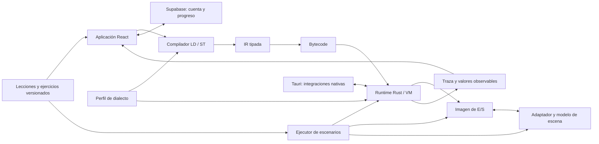

# PLC Academy — Documento de diseño inicial
Oct 15, 2026 · @Santi
Resumen ejecutivo
PLC Academy (nombre provisional) es una aplicación web y de escritorio para aprender a
programar PLC con lecciones guiadas, ejercicios autocorregidos y una planta virtual que
reacciona al programa del alumno. Recomendación: MVP con Ladder (LD) + Structured
Text (ST), un único runtime propio y 6 escenas de planta, en unas 38 semanas a 10
h/semana (beta a finales de julio de 2027); v1.0 con FBD, SFC, tres perfiles de marca y
modo profesor hacia enero de 2028.
Decisión clave de alcance: no emular el firmware real de cada marca. Es inviable
(formatos cerrados, licencias) y ya existe para uso profesional (PLCSIM, Studio 5000
Emulate). Lo que se emula es el dialecto: direccionamiento, mnemónicos, tipos de datos,
semántica de temporizadores y aspecto del editor de cada fabricante, sobre un runtime
IEC 61131-3 común. Para enseñar, eso cubre el 90 % de lo que cambia entre marcas.
Hueco de mercado: las herramientas existentes son o simuladores de planta sin currículo
(Factory I/O), o IDE profesionales sin didáctica (CODESYS, TIA Portal), o simuladores
antiguos de una sola marca (LogixPro). Ninguna combina multimarca + itinerario guiado +
autocorrección + interfaz moderna. Datos de mercado de memoria, sin verificar.
Público objetivo y objetivos didácticos
El usuario principal es el alumno de FP de Automatización y Robótica Industrial; el
profesor es quien decide la compra, así que el modo profesor no es opcional a medio plazo.
Perfil Necesidad Qué le ofrecemos
Alumno de FP /
ingeniería
Practicar sin PLC físico ni
licencias
Planta virtual + ejercicios
autocorregidos
Profesor Preparar prácticas y seguir al
grupo
Clases, asignación de ejercicios,
panel de progreso, editor de
ejercicios
Técnico de
mantenimiento
Leer y modificar programas de
una marca concreta
Perfiles de dialecto (Siemens,
Rockwell…) y ejercicios de
diagnóstico
PLC Academy — Documento de diseño inicial
Page 1 of 10
Al terminar el itinerario, el alumno debe saber:
1. Explicar el ciclo de scan (lectura de entradas → ejecución → escritura de salidas) y sus
consecuencias.
2. Resolver lógica combinacional y secuencial en LD y ST: enclavamientos, flancos,
temporizadores, contadores.
3. Modelar un proceso como máquina de estados (SFC o CASE en ST).
4. Trabajar con datos: tipos, arrays, estructuras, FB reutilizables.
5. Diagnosticar un programa ajeno con forzado de variables y traza temporal.
6. Trasladar un mismo programa entre dialectos de fabricante.
Características
El MVP se limita a lo que hace útil la herramienta en un aula: editar, simular, ver el porqué y
recibir corrección. Todo lo demás espera a validar que se usa.
Perfil Necesidad Qué le ofrecemos
Autodidacta /
reconversión
Itinerario claro de cero a
empleable
Currículo por niveles con
certificado interno
Característica Versión Valor didáctico
Editor Ladder con paleta de instrucciones
arrastrables
MVP Entrada natural para quien
empieza
Editor ST con autocompletado y errores en
línea
MVP Puente hacia programación
estructurada
Runtime con ciclo de scan configurable (1–
100 ms)
MVP Base de todo lo demás
Visualización de flujo de corriente en LD y
valores en vivo en ST
MVP El alumno ve por qué se activa una
salida
Modo paso a paso: pausa, un scan, cámara
lenta
MVP Hace visible el ciclo de scan
Forzado de entradas y variables MVP Diagnóstico como en planta
Traza temporal tipo analizador lógico MVP Entender flancos y
temporizadores
6 escenas de planta virtual 2D MVP Feedback inmediato y motivación
PLC Academy — Documento de diseño inicial
Page 2 of 10
Lenguajes PLC y dialectos por marca
Se soportan los lenguajes de IEC 61131-3 salvo IL, que la 3.ª edición de la norma declara
obsoleto. LD y ST van primero: LD es lo que más se encuentra en planta y ST es hacia
donde va la industria.
Característica Versión Valor didáctico
Ejercicios con autocorrección por
escenarios
MVP Practicar sin profesor delante
Pistas graduadas (3 niveles) y explicación
de errores típicos
MVP Evita bloqueos y abandonos
Progreso por cuenta, sincronizado MVP Continuidad entre aula y casa
Editor FBD v1.0 Estándar en control de procesos
Editor SFC v1.0 Secuencias y GRAFCET
Perfiles de marca (Siemens, Rockwell,
genérico IEC)
v1.0 Empleabilidad
Modo profesor: clases, asignación, panel
de progreso
v1.0 Decisor de compra
Editor de ejercicios y escenarios v1.0 El profesor crea contenido propio
Servidor Modbus TCP y OPC UA (solo
escritorio)
v1.0 Conectar HMI reales o Factory I/O
Perfiles Omron, Mitsubishi, Schneider Posterior Cobertura de mercado
Escenas 3D Posterior Atractivo, no imprescindible
Editor de HMI sencillo Posterior Completar el ciclo PLC + SCADA
Asistente IA que revisa el programa del
alumno
Posterior Tutoría a escala
Importar/exportar PLCopen XML Posterior Llevar el trabajo a un IDE real
Lenguaje Versión Motivo
Ladder (LD) MVP El más usado en mantenimiento y en FP
Structured Text (ST) MVP Crece en programas nuevos; base para FB y
datos
PLC Academy — Documento de diseño inicial
Page 3 of 10
Cada perfil de marca define la sintaxis, el direccionamiento, los nombres de instrucciones
y las opciones de compatibilidad que soporta. No representa ni ejecuta firmware de un
fabricante. Las diferencias semánticas se declaran explícitamente en el perfil; las que no
estén implementadas producen un error visible, no una aproximación silenciosa. Así se
comparte la máquina virtual sin afirmar que todos los PLC se comportan igual.

Un ejercicio avanzado puede pedir resolver el mismo problema en dos perfiles y comparar
el programa normalizado y su comportamiento.

Emulador multimarca y arquitectura
El sistema se divide en módulos con contratos explícitos. El núcleo de ejecución está
aislado de la interfaz, la planta y el backend de cuentas; la aplicación web y la de escritorio
usan la misma implementación Rust del runtime, compilada a WASM para navegador y a
código nativo para Tauri.



Responsabilidades y límites:

| Módulo | Responsabilidad y contrato |
|---|---|
| Aplicación | Editor, controles de ejecución, visualización, y coordinación. No implementa lógica PLC; invoca compilación y ejecución mediante mensajes tipados. |
| Perfiles de dialecto | Mapean sintaxis, direcciones y mnemónicos al modelo canónico y exponen opciones de compatibilidad implementadas. El compilador los usa para normalizar el código; el runtime recibe las opciones semánticas explícitas. No contienen otro runtime. |
| Compiladores LD y ST | Analizan el lenguaje seleccionado, reportan errores con ubicación, generan una representación intermedia (IR) tipada y la bajan a bytecode. Los lenguajes adicionales se incorporan como compiladores hacia el mismo modelo canónico. |
| Runtime y VM | Ejecutan bytecode en scans deterministas, mantienen variables y estado de bloques, gestionan temporizadores con tiempo virtual y publican salidas, errores y traza. Reciben las opciones de compatibilidad del perfil, pero no conocen React, escenas ni Supabase. |
| Imagen de E/S | Valores de entradas y salidas del PLC. Cada scan lee una instantánea de entradas, ejecuta el programa y publica las salidas al final del scan. |
| Escenas | Adaptan controles y sensores a la imagen de E/S, avanzan su modelo físico con el tiempo virtual y devuelven el siguiente estado de entradas. No evalúan si la solución es correcta. |
| Ejecutor de escenarios | Carga escenarios versionados, crea una ejecución aislada, aplica entradas y fallos inyectados, y evalúa aserciones sobre E/S, variables o estado de escena. La ejecución interactiva y las pruebas llaman al mismo runtime. |
| Persistencia | El contenido pedagógico vive versionado en el repositorio. Supabase guarda cuentas y progreso; la ejecución local no depende de la red. Tauri añade los accesos nativos necesarios para comunicaciones industriales. |

Flujo de ejecución:

1. El compilador recibe el código, el lenguaje y el perfil seleccionado; devuelve IR tipada o diagnósticos con posiciones de origen.
2. El runtime crea una instancia aislada del programa y de sus bloques. En cada scan toma una instantánea de entradas, ejecuta el programa, actualiza temporizadores usando tiempo virtual y publica salidas y traza.
3. La escena consume las salidas y calcula su estado físico; sus sensores generan las entradas del scan siguiente. Las ejecuciones de autocorrección repiten ese ciclo con reloj acelerado y escenarios reproducibles.
4. La interfaz representa la traza y la escena a partir de los resultados del runtime; no mantiene una segunda implementación de la lógica.

El protocolo entre interfaz y runtime incluye mensajes versionados para compilar, iniciar, pausar, ejecutar un scan, modificar entradas, inspeccionar valores y detener. En web, el runtime corre en un Web Worker para no bloquear la interfaz. El adaptador de plataforma permite compilar el mismo núcleo Rust a WASM o a nativo; no se presupone que ambos artefactos sean el mismo binario.

Lenguaje Versión Motivo
Function Block Diagram (FBD) v1.0 Habitual en control de procesos y en Siemens
(FUP)
Sequential Function Chart
(SFC)
v1.0 Secuencias; enlaza con GRAFCET, que se
enseña en FP
Instruction List (IL) / AWL No Obsoleto; solo valor histórico
Perfil Direccionamiento Rasgos que se emulan
Genérico IEC (estilo
CODESYS)
%IX0.0, %QX0.0, variables
con nombre
Referencia de la norma; perfil por
defecto
Estilo Siemens S7-
1200/1500
%I0.0, %Q0.0, %M, DB KOP/FUP/SCL, OB1, DB de instancia,
TON/TOF IEC y S5 (S_ODT)
Estilo Rockwell Logix Tags; Local:1:I.Data.0 Rungs con XIC/XIO/OTE/OTL/OTU,
TON con .DN/.TT/.ACC, tareas y
rutinas
Estilo Omron Sysmac
(posterior)
Variables globales Muy cercano a IEC
Estilo Mitsubishi
(posterior)
X0, Y0, M0, D0 Numeración octal en X/Y,
temporizadores T0 con constante K
Estilo Schneider
(posterior)
%I0.0, %Q0.0, %MW Machine Expert, muy cercano a IEC
PLC Academy — Documento de diseño inicial
Page 4 of 10
Escenas de planta del MVP: panel de pulsadores y pilotos, puerta de garaje, semáforo con
peatones, cinta transportadora con contador, depósito con control de nivel y estación de
clasificación. Cada escena declara su tabla de E/S, su modelo físico y fallos inyectables
(sensor bloqueado, motor que no arranca) para los ejercicios de diagnóstico.
Stack tecnológico
Recomendación: runtime en Rust compilado a WebAssembly para web y a código nativo
para Tauri, con frontend React + TypeScript. El núcleo Rust es compartido entre ambas
compilaciones; la web funciona en navegador y la aplicación de escritorio puede añadir
integraciones nativas como Modbus y OPC UA.
Componentes de la pila tecnológica
Capa Elección Por qué
Runtime y
compilador
Rust → WASM (web) y nativo
(Tauri)
Scan determinista sin pausas de
GC; un núcleo compartido, con
artefactos de compilación distintos
Parser ST chumsky o tree-sitter en
Rust
Errores con posición exacta para
mostrarlos en el editor
PLC Academy — Documento de diseño inicial
Page 5 of 10
Alternativa descartada: runtime en TypeScript. Es más rápido de arrancar, pero el GC
introduce jitter en el scan y obligaría a reescribirlo para la versión de escritorio con
comunicaciones reales.
Diseño de interfaz y experiencia didáctica
La pantalla de trabajo tiene tres zonas fijas: enunciado a la izquierda, editor en el centro y
planta virtual a la derecha, con una barra inferior de traza y variables. El alumno nunca
cambia de ventana para ver la causa y el efecto.
Panel izquierdo (enunciado): objetivo, tabla de E/S de la escena, criterios de éxito
como checklist que se marca sola, botón de pista.
Centro (editor): pestañas por POU, paleta de instrucciones, selector de perfil de
marca en la cabecera.
Derecha (planta): escena animada; pulsadores y sensores clicables para forzar
entradas.
Capa Elección Por qué
Frontend React 18 + TypeScript + Vite Ecosistema maduro para editores
visuales
Editor ST Monaco con gramática propia Autocompletado, marcadores de
error, mismo motor que VS Code
Editores LD / FBD
/ SFC
Rejilla SVG propia (LD); React
Flow (FBD, SFC)
LD es una rejilla, no un grafo libre;
FBD y SFC sí son grafos
Planta virtual 2D PixiJS + motor de física ligero
(Rapier2D)
60 fps en portátiles de aula; cajas
que caen y se mueven de verdad
UI Tailwind + Radix UI Accesible y rápida de construir
Escritorio Tauri 2 ~10 MB frente a ~150 MB de
Electron; acceso nativo a red para
Modbus/OPC UA
Backend Supabase (Postgres + auth +
RLS)
Cuentas, progreso y clases sin
mantener servidor propio
Contenido Lecciones en MDX + ejercicios
en YAML en el repo
Versionables y revisables como
código
Pruebas cargo test (runtime), Vitest,
Playwright
El runtime necesita la cobertura
más alta: un fallo ahí enseña mal
PLC Academy — Documento de diseño inicial
Page 6 of 10
Barra inferior: controles Run / Pausa / Un scan / Cámara lenta, tabla de vigilancia y
traza temporal.
Barra superior: progreso del nivel y estado del PLC (RUN/STOP, tiempo de scan).
Principios didácticos que guían cada decisión:
1. Ver antes que leer. Corriente en LD, valores en ST y sincronía con la escena en tiempo
real.
2. Error como lección. Cada fallo de autocorrección dice qué escenario falló, en qué
instante y qué esperaba; enlaza al punto de la traza.
3. Pistas graduadas. Nivel 1 orienta, nivel 2 señala la instrucción, nivel 3 muestra un
fragmento; cada pista resta puntos.
4. Andamiaje decreciente. Primeros ejercicios con esqueleto ya hecho; los últimos, en
blanco.
5. Gamificación sobria. Estrellas por ejercicio (resuelto, sin pistas, programa mínimo) y
racha; sin rankings públicos.
Estilo visual: tema oscuro por defecto (como los IDE), tema claro para proyector,
tipografía monoespaciada en editores, colores de estado normalizados (verde =
TRUE/corriente, gris = FALSE, ámbar = forzado, rojo = fallo). Accesible: no depender solo
del color, navegación por teclado en editores.
Currículo y ejercicios prácticos
El MVP trae 30 ejercicios en 5 niveles sobre 6 escenas; v1.0 llega a 60 con dos niveles más
(SFC y multimarca).
Nivel Contenido Escena Ejemplos de ejercicio N.º
(MVP)
1. Primeros
pasos
Ciclo de scan,
contactos NA/NC,
bobinas, AND/OR
Panel de
pulsadores y
pilotos
Encender un piloto;
marcha/paro con
prioridad a paro
6
2. Memoria y
flancos
Enclavamiento,
SET/RESET, flancos
R_TRIG/F_TRIG
Puerta de
garaje
Abrir/cerrar con
finales de carrera;
inversión de giro con
enclavamiento
6
3. Tiempo y
conteo
TON, TOF, TP, CTU,
CTD
Semáforo; cinta
con contador
Semáforo con
peatones; contar 10
cajas y parar
7
PLC Academy — Documento de diseño inicial
Page 7 of 10
Autocorrección por escenarios. Cada ejercicio define en YAML una lista de escenarios:
secuencia temporizada de entradas y aserciones sobre salidas o estado de la escena (por
ejemplo, «tras pulsar paro, el motor está parado en ≤ 1 scan»). El runtime los ejecuta en
tiempo acelerado, en segundos, y devuelve qué aserción falló y en qué instante. Es el
mismo enfoque que los tests unitarios, aplicado a la planta.
Cada lección sigue el mismo patrón: concepto (3–5 min de lectura con animación), ejemplo
guiado editable, ejercicio autocorregido y reto opcional.
Plazos
Con 10 h/semana desde el 2 de noviembre de 2026, la beta cerrada del MVP llega el 25 de
julio de 2027 (38 semanas, unas 380 h) y la v1.0 el 9 de enero de 2028 (unas 620 h).
Nivel Contenido Escena Ejemplos de ejercicio N.º
(MVP)
4. Procesos Comparadores,
analógicas,
escalado, histéresis
Depósito con
nivel y bomba
Control todo/nada con
alarmas de máximo y
mínimo
6
5. Secuencias
en ST
CASE como
máquina de
estados, FB propios
Estación de
clasificación
por color y
altura
Clasificar piezas en 3
rampas; modo
manual/automático
5
6. SFC (v1.0) Etapas,
transiciones,
divergencias
Mezcladora;
ascensor de 3
plantas
Ciclo de mezcla con
dosificación; llamadas
de ascensor
—
7. Multimarca
y diagnóstico
(v1.0)
Traslado entre
perfiles,
depuración de
programas ajenos
Todas Portar un programa de
Siemens a Rockwell;
encontrar 3 fallos en
un programa dado
—
PLC Academy — Documento de diseño inicial
Page 8 of 10
El calendario no lleva colchón: con un 20 % de margen, habitual en un primer proyecto de
este tamaño, la beta pasa a septiembre de 2027. A 15 h/semana se adelanta a finales de
abril de 2027.
plan por fases · 6 fases, 2 hitos
Fase Entregable verificable al cerrar la fase Horas
F0 Prototipo técnico Runtime mínimo en WASM ejecutando ST con un
TON; editor LD de prueba con 200 peldaños fluido
en un portátil de aula
60
F1 Runtime, LD y ST Compilador LD y ST completo (tipos básicos,
TON/TOF/TP, CTU/CTD, flancos, FB); valores en
vivo, paso a paso y forzado
140
F2 Planta y autocorrección 6 escenas con física, motor de escenarios YAML,
traza temporal, cuentas y progreso
100
F3 Currículo y beta 30 ejercicios con pistas; beta cerrada con 2–3
grupos de FP
80
F4 FBD y perfiles de marca Editor FBD; perfiles estilo Siemens y Rockwell; 15
ejercicios nuevos
120
F5 SFC, profesor, Modbus Editor SFC, modo profesor, editor de ejercicios,
Modbus TCP y OPC UA en escritorio; 15 ejercicios
120
PLC Academy — Documento de diseño inicial
Page 9 of 10
Riesgos, aspectos legales y decisiones abiertas
El mayor riesgo es el alcance: un editor Ladder bien hecho ya es un proyecto en sí. La
mitigación es cortar por fases y no empezar un perfil de marca hasta tener la beta en
manos de usuarios reales.
Decisiones abiertas:
Riesgo Impacto Mitigación
Alcance excesivo para una persona a
tiempo parcial
Alto MVP cerrado (LD + ST, 6 escenas);
todo lo demás, tras la beta
Semántica del runtime incorrecta
(temporizadores, flancos)
Alto: enseña
mal
Batería de tests contrastada con
CODESYS y un PLC físico de la
oficina
Uso de marcas registradas (Siemens,
Rockwell…)
Medio Solo uso nominativo («estilo S7-
1200»), sin logotipos ni copia de la
interfaz, aviso de no afiliación
Conflicto con el empleo actual Medio Revisar el contrato (propiedad
intelectual, no competencia) y
desarrollar fuera de horario y con
equipo propio
Editores visuales lentos en portátiles
de aula
Medio Prueba de rendimiento en F0 con
200 peldaños
Pocos usuarios para validar Medio Contactar con 2–3 profesores de FP
antes de F2 para la beta cerrada
¿Proyecto personal, open source o comercial? Condiciona licencia del runtime y
modelo de backend.
¿Modelo de negocio? Gratis para alumnos y licencia por centro es la opción natural si
es comercial.
Dedicación real semanal: el calendario asume 10 h/semana.
Nombre definitivo y dominio.
Idiomas: español en el MVP; ¿inglés en v1.0?
PLC Academy — Documento de diseño inicial
Page 10 of 10

Implementación inicial
La base de código empieza con un workspace Rust y una aplicación web React:

```text
apps/
  web/                 Aplicación React + TypeScript + Vite
crates/
  plc-runtime/         Máquina de ejecución IEC mínima y pruebas
Cargo.toml             Workspace Rust
```

El runtime ejecuta un subconjunto booleano de Structured Text: declaraciones `BOOL` de
entrada, salida e internas (`VAR`), asignaciones, comentarios `//` y `(* ... *)`, y
expresiones con `AND`, `OR`, `NOT` y paréntesis. Los comentarios de bloque sin cerrar
producen un error con ubicación. Las variables internas retienen su estado entre scans; cada
scan toma una instantánea de entradas y confirma de forma atómica los cambios de salidas y
memoria. El periodo aceptado es de 1 a 100 ms. La vista web compila el mismo runtime a
WebAssembly y permite editar y compilar ST, cambiar entradas, inspeccionar memoria y
ejecutar scans paso a paso o en ciclo automático. Junto al simulador se puede alternar
entre el ST y una representación Ladder de la práctica Marcha/Paro: dos peldaños,
contactos NO/NC que muestran apertura, cierre y continuidad, enclavamiento, bobinas
y ecuaciones con seguimiento del peldaño activo. La animación usa la imagen de entradas
muestreada, memoria, salidas y runtime; los cambios pendientes se identifican hasta
ejecutar el scan. La vista incluye un editor visual experimental que permite arrastrar o
añadir contactos NO/NC y bobinas a esos peldaños y retirarlos. Los elementos añadidos son
solo visuales: aún no alteran el programa ejecutado ni se compilan como LD; el editor
general y la compilación de programas LD personalizados aún no están implementados.
Temporizadores, contadores y escenas todavía no están implementados. En el editor,
`Enter` conserva la sangría, continúa comentarios `//` y `(* ... *)`, expande
pares vacíos y crea líneas indentadas antes de cierres `)`/`*)`; también ajusta tras
`VAR`/`END_VAR`. `Tab` y
`Shift+Tab` ajustan la sangría, `Backspace` la reduce en el margen, y
`Ctrl/Cmd + /` comenta o descomenta las líneas,
los paréntesis y los comentarios de bloque se completan automáticamente y
`Backspace` elimina juntos los pares vacíos; `Ctrl/Cmd + Enter` compila el
programa. `Ctrl/Cmd + S` también compila sin abrir el diálogo del navegador.
`Ctrl/Cmd + Z` deshace y `Ctrl/Cmd + Shift + Z` rehace cambios, incluidos los
atajos de edición.
El editor muestra números de línea
sincronizados con el desplazamiento y señala línea y columna de los errores de
compilación, que se validan automáticamente mientras se escribe; el botón
«Ir al error» lleva al carácter señalado sin interrumpir la escritura. La sintaxis se
resalta también en directo, ilumina la línea activa y no bloquea la edición ni
la selección del texto. Durante la traza, la
vista del programa acompaña la línea activa para mantener visible la ejecución
en programas largos.

El aula incluye además una práctica de comunicaciones con generador e inspector
de peticiones Modbus RTU (CRC-16 calculado) y Modbus TCP (cabecera MBAP), junto
a esquemas didácticos de PROFINET IO y EtherNet/IP para distinguir capas,
direcciones y tipos de tráfico. Los esquemas de PROFINET y EtherNet/IP no
representan capturas completas: los bytes exactos dependen de la configuración
del dispositivo y de la conexión. El simulador muestra también una cinta
transportadora visual cuyo movimiento sigue la salida `Q0.0 Motor`; por ahora
es una vista unidireccional, los sensores se accionan manualmente y no hay
modelo físico ni realimentación desde la planta al PLC. Al pausar el ciclo
automático se congela la animación, aunque el estado de la salida del motor
permanezca activo.

Requisitos de desarrollo: Node.js 20 o posterior, npm y Rust estable con Cargo.

```sh
cd apps/web
npm install
npm run dev
```

Desde la raíz del repositorio, las verificaciones son `npm --prefix apps/web run build` y
`cargo test -p plc-runtime`.